  

<pre>
<b>❯ ls ~/projects --sort=recent</b>

  <a href="https://github.com/AthanasiosPapazoglou/scrapyard_derby">scrapyard_derby/</a>    dart   one-button physics game — spin, land, bounce, fall apart
  <a href="https://github.com/AthanasiosPapazoglou/MacroCal">MacroCal/</a>           dart   cross-platform calorie & macro tracker
  <a href="https://github.com/AthanasiosPapazoglou/pika_dex">pika_dex/</a>           dart   personal pokédex: type matchups & stats board
  <a href="https://github.com/AthanasiosPapazoglou/gwent">gwent/</a>              dart   the Witcher 3 card game, rebuilt in Flutter
  <a href="https://github.com/AthanasiosPapazoglou/exp_margins">exp_margins/</a>        dart   expenses & cash-flow with a twist
</pre>

<pre>
<b>❯ ./snake --feed=contributions</b>
</pre>

  

<pre>
<b>❯ cat ~/.config/socials.toml</b>

  linkedin  = "<a href="https://www.linkedin.com/in/athanasios-papazoglou-89706b192/">in/athanasios-papazoglou</a>"
  instagram = "<a href="https://www.instagram.com/thanos_papazoglou_/">@thanos_papazoglou_</a>"
  location  = "Sønderborg, DK  ⇄  Greece"

<b>❯</b> █
</pre>
